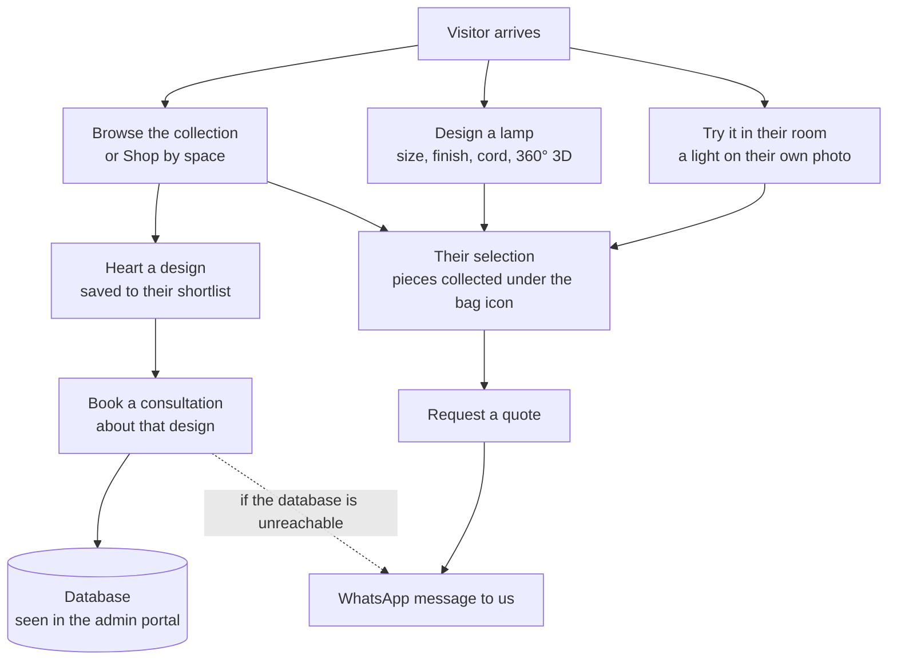

# LumaDesign Website Guide

*Updated 21 November 2026 for the owners. No coding knowledge needed.*

The LumaDesign website lets a visitor browse our lights (54 today), explore ideas room by room, design a lamp and turn it 360° in 3D, preview it in a photo of their own room, and then request a quote or book a consultation. It does not take payments. The owners change the content in a private admin portal.

A full list of what the admin and the customer can do is in [FEATURES.md](FEATURES.md).

**Contents**

1. [At a glance](#1-at-a-glance)
2. [The pages and what is on them](#2-the-pages-and-what-is-on-them)
3. [The visitor journey](#3-the-visitor-journey)
4. [When a request arrives](#4-when-a-request-arrives)
5. [What works today and what is missing](#5-what-works-today-and-what-is-missing)
6. [How to change a photo](#6-how-to-change-a-photo)
7. [How to change contact details, prices and text](#7-how-to-change-contact-details-prices-and-text)
8. [How to preview and publish](#8-how-to-preview-and-publish)
9. [The admin portal and what comes next](#9-the-admin-portal-and-what-comes-next)
10. [Before launch checklist](#10-before-launch-checklist)

---

## 1. At a glance

Every path on the website ends with the customer contacting us.

Quote requests arrive as WhatsApp messages. Consultation requests are saved in the database and handled in the admin portal (see section 4).

---

## 2. The pages and what is on them

The website has four public pages. The menu at the top links to all of them and stays visible while scrolling. A fifth, private page is the admin portal at `/admin/`, for the owners only; search engines are told not to list it.

| Page | Address | What the visitor does there |
| --- | --- | --- |
| Home | `/` | Everything below in one long page |
| Shop by space | `space.html` | Picks Bedroom, Living room, Dining, Office or Outdoor and sees the designs we suggest for that room, each on its own page with a banner photo |
| About | `about.html` | Reads our philosophy, what makes us different, how we work and what we care about |
| Contact | `contact.html` | Calls or WhatsApps us, books a consultation, or finds our social media |

The home page, from top to bottom:

| Section | What the visitor does there |
| --- | --- |
| Top banner | Sees room photos that change every few seconds (set in the portal), with two buttons: browse the collection, or request a quote |
| Three shortcut cards | Chooses a starting point: browse, design a lamp, or try a light in their room |
| Shop by space | Taps a room to open its page |
| Featured designs | Optional strip of hand-picked designs, shown only when the owners turn it on in the portal |
| Collections | Browses all designs (54 today), filters by collection (wall lights, ceiling lights, chandeliers, or any collection the owners add), searches by name or reference, opens a design for details, or taps the heart to save it |
| How it works | Reads the three steps: choose, customise, talk to us |
| Design your lamp | Picks a design, size, finish and cord. The 3D model updates with every choice and can be turned all the way round, tilted and zoomed |
| Try in your room (Room Studio) | Uploads a room photo (or a 360° photo, or our sample room), matches the room with two lines, places our real 3D lights on the ceiling and walls, adjusts them, and saves the design or sends it to us with a consultation request |
| About | A short introduction with a link to the About page |
| Saved designs | Appears only after the visitor saves something. Lists their hearts and saved lamp designs, each with a **Discuss** button |
| Footer | Our phone, WhatsApp and the links again |

Four small windows open on top of any page: **design details**, **Your selection**, **Request a quote**, and **Book a consultation**.

### The 3D lamp designer

- The 3D model matches the design chosen. There are 54 3D shapes, one for each original design; a new design added in the portal reuses the closest shape. Wall lights sit on a wall, ceiling lights on a ceiling, chandeliers hang on a cord.
- **Size** (19, 33 or 42 cm wide) makes the model visibly smaller or larger. **Finish** recolours the metal. **Cord** changes the hanging cord on chandeliers and the plug-in cord on wall lights. Ceiling lights need no cord, so that step is hidden and its price is left out.
- Visitors turn it by dragging with a mouse or a finger, zoom with the + and − buttons or by pinching, and can press the layers button to see the parts pulled apart. On phones the 3D view stays at the top of the screen while the options scroll underneath.
- The model is a simplified picture for comparing shapes, sizes and finishes. The photo of the real product is one tap away ("Photo").

---

## 3. The visitor journey

1. **Arrives** on the home page, or straight on a room page from a link.
2. **Explores** in one or more ways: browse the collection, shop by room, design a lamp in 3D, or place a light on a photo of their room.
3. **Saves** what they like. The heart puts a design on their shortlist. A small message then offers **Discuss this design**, without stopping them from browsing. If they ignore it twice, it stops appearing for that visit.
4. **Gets in touch**, in one of two ways:
   - **Request a quote:** lists the pieces in their selection and opens WhatsApp with the message written. They press send.
   - **Book a consultation:** a short form with their name, phone, optional email, WhatsApp or phone call, an optional preferred day and time, and notes. The design they liked, and their custom size, finish and cord if they made one, are attached automatically.
5. **Sees a confirmation.** For a consultation: "Request received" with a reference such as `LD-4M1OGAFG`, and a note that the meeting is confirmed once we agree a time together. The website never shows a meeting as booked.
6. **Hears from us** by WhatsApp or phone.

---

## 4. When a request arrives

### Quote requests

They arrive as WhatsApp messages to 010 9324 4530, for example:

> Hello LumaDesign, I would like a quote for:
> 1. Rattan semi-flush (Ceiling light)
> 2. Modern cylinder · 42 cm wide · warm brass finish · white textile cord (Custom lamp) × 2
>
> Notes: Ceiling height 2.8 m, need it by December

Reply in the same chat with the price, lead time and delivery details.

### Consultation requests

Each request is saved in the database and appears in the admin portal under **Consultation requests** (see [ADMIN-GUIDE.md](ADMIN-GUIDE.md)), with the customer's details, the design and its reference, its photo, their custom setup, their preferred time and notes. If you set up the Google Sheet copy ([CONSULTATION-REQUESTS-SETUP.md](CONSULTATION-REQUESTS-SETUP.md)), it also appears there within 5 minutes, and you can get an email for each one.

What we do next, in the portal:

1. Contact the customer the way they chose (WhatsApp or phone call), within the time we promise. Set the status to **Contacted**.
2. Agree a time for the consultation and set it to **Meeting scheduled**. Add private notes as you go.
3. Then **In progress**, and finally **Completed** or **Cancelled**.

If the database cannot be reached when the customer presses Send, the form hands the request to WhatsApp with all the details written. In that case it only reaches us if the customer presses send in WhatsApp.

---

## 5. What works today and what is missing

| Part | Status on 21 Nov 2026 |
| --- | --- |
| All four pages, menu, search, filters, shortlist, selection | Working. Checked at phone, tablet, laptop and wide-screen sizes |
| 3D lamp designer | Working for every design, with 360° turning, tilting, zoom, explode and every option shown on the model |
| Shop by space pages | Working for all five rooms, using our existing room photos |
| Quote requests by WhatsApp | Working, sent to 010 9324 4530 |
| Call button | Working (`+20 109 324 4530`) |
| Consultation form | Working: checks every field, attaches the design and setup, shows a clear confirmation |
| Consultation requests | Saved in the database and managed in the admin portal. The Google Sheet copy is optional and needs a 10-minute setup |
| Admin portal | Working and tested: requests, photos, rooms, preview and publishing |
| Business dashboard (portal) | Working: inquiry figures, charts and a Needs attention list. Sales, costs, profit and visits are not recorded yet |
| Database kept awake | A daily GitHub job stops the free database from pausing |
| Instagram and TikTok | Hidden until we add the links in the portal |
| Email address, city, opening hours | Hidden until we add them |
| Prices in the lamp designer | Hidden ("Price: On request") until we enter our real prices in Settings and switch on "Show these prices on the website" |
| Privacy policy | Page `privacy.html`, linked in every footer and under the consultation form. Read and approve it before launch |
| Backups | Run `backup-database.bat` regularly; the free plan keeps none |
| Price on each design | Shows "On request" until we add prices |

**Not yet tested:** a real message arriving on our phone, real iPhones and Android phones in hand, screen-reader software, changing the admin password, and the optional Google Sheet copy (it can only be tested after it is set up).

---

## 6. How to change a photo

Use the admin portal: **Media library** to upload or replace photos, then choose them where they are used (Homepage slides, Shop by space, Designs, About us, Contact us). Publish when ready. See [ADMIN-GUIDE.md](ADMIN-GUIDE.md).

Replacing a photo in the Media library updates every place that uses it.

Good photos for this site:

- **Lights:** plain background, lamp in the middle with space around it. Wall and ceiling lights as tall photos, chandeliers as square photos.
- **Room photos:** wide, at least 1600 pixels across, with the main subject on the right. Headlines sit on the left. Set the focal point so phones keep the important part in view.

The older `update-images.bat` tool still replaces the photos that came with the website, but those changes only go live through a commit and push (section 8). The Media library is simpler and needs neither.

---

## 7. How to change contact details, prices and text

Everything is edited in the admin portal and goes live when you press **Publish**:

| To change | Where in the portal |
| --- | --- |
| Phone, WhatsApp, email, city, opening hours, Instagram, TikTok, other links | Contact us |
| Lamp designer prices, booking calendar link | Settings |
| Price, size, material and lead time of a design | Designs |
| Product names, descriptions, photos, adding or hiding designs | Designs |
| Which designs appear on each room page, and its title, intro and photo | Shop by space |
| Filters above the product grid | Collections |
| Headlines, slides, sections and their order | Homepage, About us, Contact us |

A brand-new kind of section, a new page or a new 3D shape still needs a developer.

---

## 8. How to preview and publish

**Content changes** (text, photos, designs, rooms, contact details, prices) are published from the admin portal with the **Publish** button. They need nothing below.

**Code changes** (layout, new features) work differently. The website has two copies: the working copy in the project folder on a computer, and the public copy on the internet. A code change shows publicly only after it is published as described here.

**Preview on a computer.** Double-click `preview.bat` in the project folder. A black window opens and the site appears in the browser at `http://localhost:8124`. Keep the black window open while looking, and close it when finished. Only that computer can see the preview.

**Where the public site lives.** It is hosted free on GitHub Pages, from the GitHub account `Ykashef97`, project `Lumoostudio30`. The public address shows the `main` branch.

**Publish a change.** Save the changed files into the project's history (a "commit") and upload them to GitHub (a "push"), then merge them into the `main` branch. The public site updates by itself one or two minutes later. This needs someone signed in to the GitHub account that owns the project, or invited to it as a collaborator.

**A new public address.** See [HOW-TO-CREATE-A-NEW-LINK.md](HOW-TO-CREATE-A-NEW-LINK.md).

---

## 9. The admin portal and what comes next

The admin portal (stage 3 of the earlier plan) is built: a private login where we edit the website and handle consultation requests. It runs on Supabase's free plan (database, login and photo storage) alongside the free GitHub Pages hosting. Guides: [ADMIN-SETUP.md](ADMIN-SETUP.md) for the one-time setup and [ADMIN-GUIDE.md](ADMIN-GUIDE.md) for daily use.

Possible next steps, only when the reason for them appears:

| Step | Move here when | Effort and cost |
| --- | --- | --- |
| Arabic version of the site | Customers ask for it | Several days |
| Sales, costs, profit and visitor figures in the Business dashboard | We want to see real sales and profit | Planned in [BUSINESS-DASHBOARD-PROPOSAL.md](BUSINESS-DASHBOARD-PROPOSAL.md), free to run. Start with the meeting questions in [OWNER-DISCOVERY-QUESTIONNAIRE.md](OWNER-DISCOVERY-QUESTIONNAIRE.md) |
| Our own web address (e.g. lumadesign.com) | Before printing it on cards or ads | An hour plus the yearly domain fee |
| Online ordering and payment, real booking calendar | Requests outgrow WhatsApp and the portal | Weeks of development, monthly fees, plus privacy and refund policies |

The free Supabase plan includes a 500 MB database and 1 GB of photo storage, far more than this site needs. Supabase pauses a free project after a week with no activity. To prevent that, a small daily job on GitHub (Actions → "Keep database awake") asks the database for the website content once a day, like a visitor would. If GitHub ever emails that this job failed, or that it was turned off (GitHub stops scheduled jobs after 60 days without any commit), open the project on supabase.com and press **Restore project** if it is paused, then on GitHub open **Actions → Keep database awake** and press **Enable workflow** or **Run workflow**. While the database is paused the website still opens with its built-in content, and requests fall back to WhatsApp.

---

## 10. Before launch checklist

- [x] Add our WhatsApp number (done: 010 9324 4530)
- [x] Create the admin account and sign in to the portal
- [x] Put the portal and the daily keep-awake job live (merged into `main`)
- [ ] Optional: set up the Google Sheet copy of requests
- [ ] Enter our real lamp-designer prices and switch on "Show these prices on the website" (portal: Settings), then Publish. Until then the designer shows "Price: On request"
- [ ] Read and approve the privacy policy (`privacy.html`)
- [ ] Make the first backup with `backup-database.bat`
- [ ] Read and approve the About page, the room page introductions and the three promises
- [ ] Add our Instagram and TikTok links (portal: Contact us)
- [ ] Publish the new version, then send ourselves a test quote and a test consultation from a phone
- [ ] Add email, city and opening hours if we want them shown
- [ ] Add price, size, material and lead time for each design (portal: Designs)
- [ ] Check which designs appear on each room page
- [ ] Test on one iPhone and one Android phone
- [ ] Decide on the public address (see the new-link guide)
