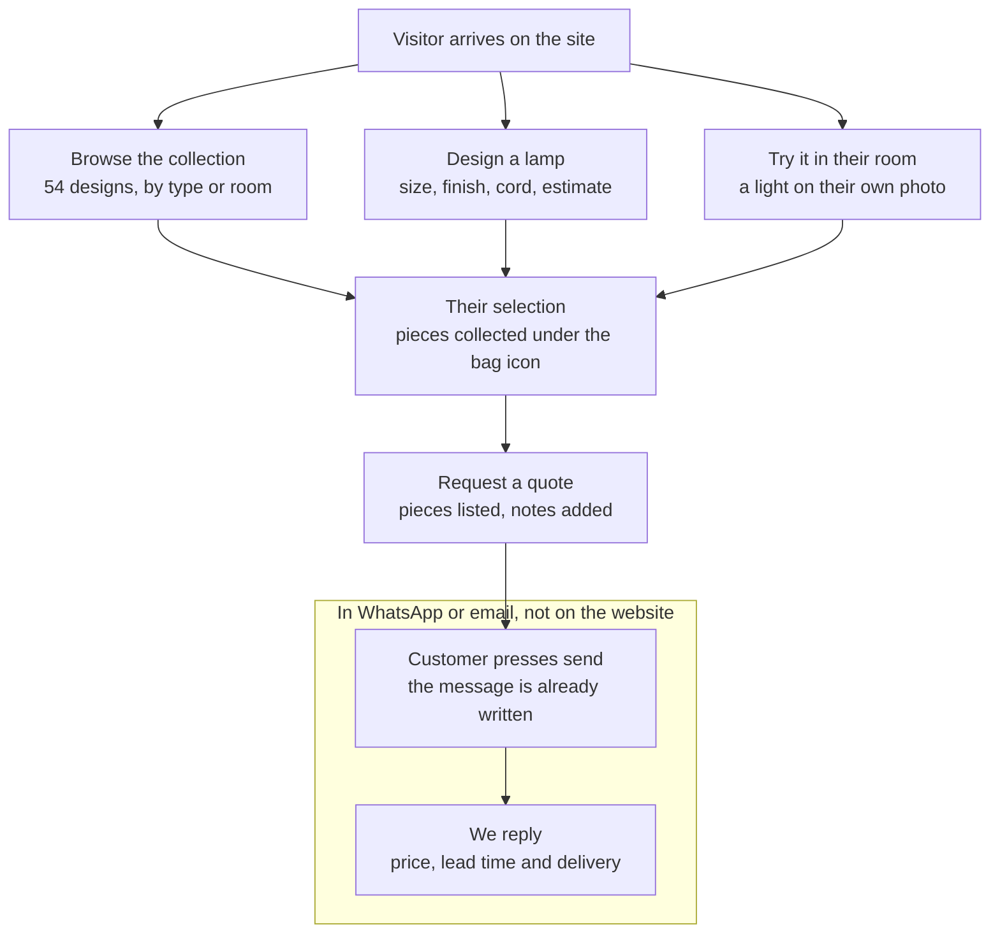

# LumaDesign Website Guide

*Written 14 November 2026 for the owners. No coding knowledge needed.*

The LumaDesign website lets a visitor browse 54 lights, design a lamp, preview it in a photo of their own room, and send us a quote request by WhatsApp or email. It does not take payments.

**Contents**

1. [At a glance](#1-at-a-glance)
2. [What is on the website](#2-what-is-on-the-website)
3. [The visitor journey](#3-the-visitor-journey)
4. [When a quote request arrives](#4-when-a-quote-request-arrives)
5. [What works today and what is missing](#5-what-works-today-and-what-is-missing)
6. [How to change a photo](#6-how-to-change-a-photo)
7. [How to change contact details, prices and text](#7-how-to-change-contact-details-prices-and-text)
8. [How to preview and publish](#8-how-to-preview-and-publish)
9. [Do we need a dashboard?](#9-do-we-need-a-dashboard)
10. [Before launch checklist](#10-before-launch-checklist)

---

## 1. At a glance

Every path on the website ends in a quote request sent to us.

A visitor can also press "Request a quote" straight from a design, the lamp designer or the menu. The piece is then added to the selection automatically. Everything in the last box happens in WhatsApp or email, where we take over.

---

## 2. What is on the website

The site is one long page. The menu at the top jumps to each part and stays visible while scrolling.

| Section | What the visitor does there |
| --- | --- |
| Top banner | Sees five room photos that change every few seconds, with two buttons: browse the collection, or request a quote |
| Three shortcut cards | Chooses a starting point: browse, design a lamp, or try a light in their room |
| Shop by space | Picks Bedroom, Living room, Dining, Office or Outdoor and sees suggested lights for it |
| Collections | Browses all 54 designs (9 wall lights, 25 ceiling lights, 20 chandeliers), searches by name, opens a design for details, or taps the heart to save it |
| How it works | Reads the three steps: choose, customise, request a quote |
| Design your lamp | Picks a design, shade size, finish and cord, and sees an estimated price. Can switch to a simple 3D preview |
| Try in your room | Uploads a room photo (or uses our sample room), clicks where the light should go, and downloads the picture |
| About | Reads who we are and three promises: free consultation, no surprises, photos stay private |
| Saved designs | Appears only after the visitor saves something. Lists their hearts and saved lamp designs |
| Footer | Finds our contact details and the links again |

Three small windows open on top of the page:

- **Design details:** photo, description and price line of one design.
- **Your selection:** the list of pieces the visitor picked.
- **Request a quote:** the message that gets sent to us.

---

## 3. The visitor journey

1. **Arrives** on the top banner and reads the headline: "Find or create the perfect lighting for your space".
2. **Explores** in one of three ways. They can use one, two or all three:
   - *Browse:* opens Collections, filters by type or by room, and opens a design to read about it.
   - *Design:* builds a lamp by choosing a design, shade size, finish and cord. The estimate updates with each choice.
   - *Preview:* places a light on a photo of their own room and downloads the result.
3. **Collects** what they like. "Add to selection" puts a piece in their selection (the bag icon at the top). The heart saves it to a shortlist for later.
4. **Requests a quote.** The "Request a quote" button is in the menu, the top banner, every design's details, the lamp designer, the shortlist and the selection.
5. **Reviews the message.** A window lists the chosen pieces and has a box for notes such as room size, ceiling height or quantity.
6. **Sends it.** They choose WhatsApp, email, or copy the text. WhatsApp or their email app opens with the message already written, and they press send there.
7. **Hears from us.** We reply with the price, lead time and delivery details. Everything after this happens in WhatsApp or email, not on the website.

A visitor with nothing selected can still press "Request a quote". It then sends a general message asking for help choosing lighting.

---

## 4. When a quote request arrives

A request reaches us as an ordinary WhatsApp message or email. The website does not keep a copy, so the chat or email is our only record.

The message looks like this:

> Hello LumaDesign, I would like a quote for:
> 1. Rattan semi-flush (Ceiling light)
> 2. Modern cylinder · 42 cm shade · soft ivory · white textile cord (Custom lamp) × 2
>
> Notes: Ceiling height 2.8 m, need it by December

What we do next:

1. Reply in the same chat or email with the price, lead time and delivery details.
2. Ask for anything missing, such as room size, quantity or delivery address.
3. Agree the order and payment directly with the customer. The website is not involved in payment.

Because nothing is saved on the website, keep a shared list of requests from day one. A spreadsheet with date, customer, items, price quoted and status is enough.

---

## 5. What works today and what is missing

The WhatsApp button works, but it does not reach us yet, because our phone number has not been entered into the website.

| Part | Status on 14 Nov 2026 |
| --- | --- |
| Browsing, search, filters, shortlist, selection | Working. Checked on phone, tablet and computer screen sizes |
| Lamp designer and 3D preview | Working |
| Room preview and download | Working, including the sample room |
| Building the quote message | Working. The text and item list were checked |
| WhatsApp button | Opens WhatsApp with the message written. With no number set, the visitor is asked to pick a contact, so it does not reach us |
| Email button | Opens the email app with the message written. With no address set, the "To" line is empty |
| Contact details in the footer | Empty until we add our number, email, city and hours |
| Prices in the lamp designer | Sample figures from the earlier draft. Must be replaced with our real prices |
| Price on each design | Shows "On request" until we add prices |

**How the WhatsApp link works.** It is WhatsApp's standard "click to chat" link. It opens a chat with our number and a prepared message, and the customer presses send. There are no automatic replies, and the website cannot tell whether a message was sent.

**Not yet tested:** an actual message arriving on our phone, real iPhones and Android phones, and screen-reader software.

---

## 6. How to change a photo

Put the new photo in the `new-images` folder with the right name, then double-click `update-images.bat`. No editing of code is needed.

1. Open the project folder, then the `new-images` folder.
2. Open `IMAGE-NAMES.txt` and find the photo to replace. Example: the "Pleated shade arm" wall light is `sconces-02`, and the bedroom banner photo is `hero-bedroom`.
3. Rename the new photo to that name and put it in `new-images`. Example: `sconces-02.jpg`. JPG, PNG and WEBP all work, and several photos can be added at once.
4. Go back to the project folder and double-click `update-images.bat`. It resizes each photo, replaces the old one, and lists what it updated or skipped and why.
5. Double-click `preview.bat` to check the result. If the old photo still shows, press Ctrl+F5.
6. Publish (section 8) so the public website gets the new photo.

The original photo is kept in `new-images/done` with the date in its name.

Good photos for this site:

- **Lights:** plain background, lamp in the middle with space around it. Wall and ceiling lights as tall photos, chandeliers as square photos.
- **Room photos:** wide, at least 1600 pixels across, with the main subject on the right. The headline sits on the left.

Limits:

- This replaces existing photos only. Adding a new product, removing one, or renaming one needs a change to the product list in the code.
- The computer needs Python installed (free from python.org). The first run also downloads a small image tool.

---

## 7. How to change contact details, prices and text

Contact details and prices live in one clearly marked block at the top of one file: `assets/js/app.js`, under the heading SETTINGS. Open the file with Notepad, change only the text between the quote marks, and save.

| To change | Where | What it looks like |
| --- | --- | --- |
| WhatsApp number | `LUMA_CONTACT`, line `whatsapp` | `whatsapp: '201001234567'` (digits only, country code first, no + sign) |
| Email, city, opening hours | `LUMA_CONTACT`, lines `email`, `city`, `hours` | `email: 'hello@example.com'` |
| Lamp designer prices | `LUMA_PRICING` | `shade: { 19: 799, 33: 1299, 42: 1599 }`, `cord: 750`, `bulbs: 399` |
| Price, size, material and lead time of one design | `styleSpecs` | An example line is written in the file |
| Product names and descriptions | `styleCatalog` and `styleNotes`, lower in the same file | Lists of names and one description per design |
| Which designs appear under each room | `SPACES`, in the same file | A list such as `'sconces:1'` per room |
| Headlines and paragraphs on the page | `index.html` | Ordinary text between the tags |

Two rules keep this safe:

1. Keep every quote mark, comma and bracket exactly as it was.
2. Check the result with `preview.bat` before publishing. If the page looks broken after an edit, undo the change and try again.

For anything beyond these values, such as a new section or a new product, ask a developer or Claude to make the change.

---

## 8. How to preview and publish

The website has two copies: the working copy in the project folder on a computer, and the public copy on the internet. A change shows publicly only after it is published.

**Preview on a computer.** Double-click `preview.bat` in the project folder. A black window opens and the site appears in the browser at `http://localhost:8124`. Keep the black window open while looking, and close it when finished. Only that computer can see the preview.

**Where the public site lives.** It is hosted free on GitHub Pages, from the GitHub account `Ykashef97`, project `Lumoostudio30`.

**Publish a change.** Publishing means saving the changed files into the project's history (a "commit") and uploading them to GitHub (a "push"). The public site updates by itself one or two minutes later. This needs someone signed in to the GitHub account that owns the project, or invited to it.

**A new public address.** See [HOW-TO-CREATE-A-NEW-LINK.md](HOW-TO-CREATE-A-NEW-LINK.md).

---

## 9. Do we need a dashboard?

Not yet. Today the website has no login, no database and no server, which is why it is free to host and has nothing to hack. Quote requests already arrive in WhatsApp and email, and that is our inbox. A dashboard would add monthly cost and upkeep before we know how many requests we get.

Build it in stages, and move to the next stage only when the reason for it appears:

| Stage | What we use | Move here when | Effort and cost |
| --- | --- | --- | --- |
| 1. Now | WhatsApp Business app on a shared number (both partners via linked devices, with labels and quick replies), plus a shared spreadsheet of requests | Launch | No building. Free |
| 2. Easier editing | Products, prices and contact details moved into one simple data file or a Google Sheet that the site reads | We change prices or products more than about once a month | About a day of development. Free |
| 3. Editing screen | A login page where either partner edits products and photos in a form and presses Publish (a ready-made tool such as Decap CMS works with our current hosting) | Editing files feels risky, or a third person needs to update the site | Two to three days. Free or low cost |
| 4. Full dashboard | Requests saved to a database, a list of leads with status, customer accounts, online payment | We receive more requests than a spreadsheet can handle, or we want online ordering | Weeks of development. Monthly hosting and payment fees, plus privacy and refund policies |

Before stage 3 or 4 we should decide: who may edit what, whether both partners need separate logins, what must be recorded about each request, and whether customers will pay online.

---

## 10. Before launch checklist

The site is ready to publish once the first four items are done. The rest can follow in the first weeks.

- [ ] Add our WhatsApp number and email to the SETTINGS block
- [ ] Replace the sample lamp-designer prices with our real prices
- [ ] Read and approve the About text and the three promises
- [ ] Publish the new version, then send ourselves a test quote from a phone
- [ ] Add city and opening hours to the footer
- [ ] Add price, size, material and lead time for each design
- [ ] Check which designs appear under each room in "Shop by space"
- [ ] Test on one iPhone and one Android phone
- [ ] Decide on the public address (see the new-link guide)
- [ ] Start the shared spreadsheet of quote requests
